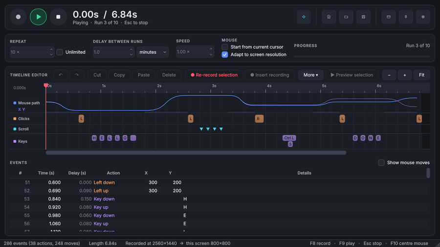
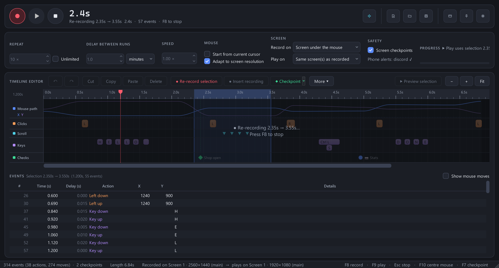
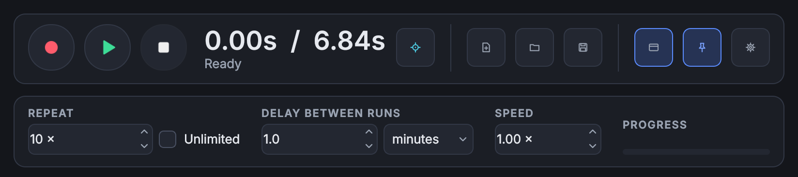
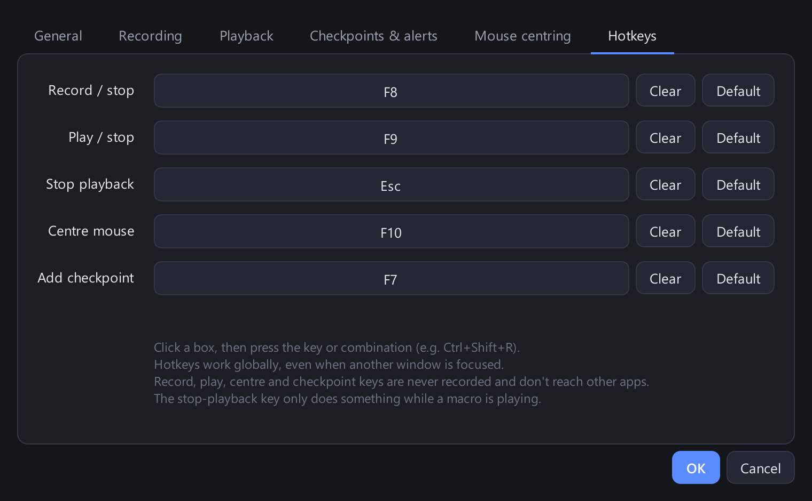

<div align="center">

# More Than Tiny Task

**Record your mouse & keyboard. Edit it like a video. Replay it as many times as you want.**

A free Windows macro recorder inspired by TinyTask, with a timeline editor, partial re-recording,
delays between runs and a one-key "centre the mouse".

[](https://github.com/BarBaroNN/more-than-tiny-task/releases/latest/download/MoreThanTinyTask.exe)
&nbsp;
[](https://github.com/BarBaroNN/more-than-tiny-task/releases/latest)



</div>

## Why not just TinyTask?

TinyTask is great until you mess up one click in a 2-minute recording and have to redo the whole thing.
More Than Tiny Task keeps the same **record → play** simplicity and adds:

| | TinyTask | More Than Tiny Task |
|---|:---:|:---:|
| Record & replay mouse / keyboard | ✅ | ✅ |
| Repeat N times or forever | ✅ | ✅ |
| **Wait between runs** (e.g. 10 runs, 1 min apart) | — | ✅ |
| **Timeline editor** (cut, copy, paste, move, delete) | — | ✅ |
| **Re-record just one part** of a macro | — | ✅ |
| **Glide the mouse to the screen centre** with a hotkey | — | ✅ |
| **Play from wherever your cursor is now** | — | ✅ |
| **Works across resolutions** (record on 1440p, play on 1080p) | — | ✅ |
| Custom hotkeys, stay on top, compact mode, tray | — | ✅ |
| Undo / redo | — | ✅ |

## Download & run

1. Download **[MoreThanTinyTask.exe](https://github.com/BarBaroNN/more-than-tiny-task/releases/latest/download/MoreThanTinyTask.exe)** (Windows 10 / 11).
2. Double-click it. No installation needed.

> **"Windows protected your PC"?** The app isn't code-signed (certificates are expensive), so SmartScreen warns about it. Click **More info → Run anyway**. Some antivirus tools also flag macro recorders because they read keyboard input. The exe is built automatically from this source code by GitHub Actions, and every release lists its SHA-256 checksum.

## How to use it

| Key | What it does |
|-----|--------------|
| **F8**  | Start / stop recording (re-records just the selected part if you've selected one) |
| **F9**  | Start / stop playback (continues from the playhead, or plays only the selected part if you've selected one) |
| **Esc** | Stop playback |
| **F10** | Glide the mouse to the centre of the screen. Works while recording, and the glide is recorded |

All hotkeys work while other windows are focused and can be changed in **Settings → Hotkeys**.
F8, F9 and F10 are never recorded and never reach the app you're using, so F10 won't open its menu bar.
**Esc only stops playback.** While recording it's just a normal key (and gets recorded), so the only way to stop a recording is F8.

1. Press **F8**, do your thing, press **F8** again.
2. Set **Repeat** (or tick *Unlimited*), an optional **Delay between runs**, and the **Speed**.
3. Press **F9**. Press **Esc** at any time to stop.
   If a part of the timeline is selected, **F9 plays just that part**, with the same repeat / delay / speed settings. Click an empty spot on the timeline to clear the selection.
   Otherwise **F9 continues from the playhead** (the red line): stop with Esc and press F9 again to pick up where it stopped, or click anywhere on the timeline to start from there. Keys and mouse buttons that were held down at that point are pressed again. Further repeats play the whole macro. Click *play from the start* under the progress bar to go back to the beginning.
4. **Ctrl+S** saves the macro as a `.mttk` file. Drag a file onto the window to open it.

### Mouse options

Two switches next to *Speed* control where the mouse goes during playback:

- **Start from current cursor:** the whole recording is shifted so it starts where your pointer is right now, instead of where it was when you recorded. Every repeat starts from that same spot. Useful for things that aren't always in the same place on screen.
- **Adapt to screen resolution** (on by default): each macro remembers the resolution it was recorded on. If you play it on a different one (for example recorded on 2560×1440, played on 1920×1080), every mouse position is rescaled so it lands on the same spot of the screen. The status bar shows both resolutions. Parts you re-record on another screen are converted automatically too.

**Screens.** Next to the mouse options, *Record on* picks the screen a recording belongs to (the one under the mouse when you start, a specific screen, or *All screens*) and *Play on* picks where it plays (the same screen(s) it was recorded on, or any screen you choose). Each macro remembers the monitor layout it was recorded with, so it doesn't matter how many screens are connected later: positions move to the matching screen (or the main one if that screen is unplugged), are rescaled to its resolution, and never end up off-screen. The status bar shows where it was recorded and where it will play.

> Rescaling works best for apps and games that fill the screen and scale their UI with the resolution. If the aspect ratio changes (16:9 → 16:10), positions are stretched to match.

### Fix one part without redoing everything


- **Drag** across the timeline to select the part you want to change. Drag the blue edges to fine-tune it.
- Press **F8** to re-record it straight away: with a selection, F8 records over just that part instead of starting a new macro.
- Or press **● Re-record selection** (Ctrl+R) or the record button. Nothing is recorded yet: get ready in the app you're recording, then press **F8** to start (Esc or Stop cancels). Do that part again and press **F8** to finish. Only the selection is replaced and everything after it shifts to fit. When you press F8 the cursor is first moved to where it was at that moment, so the new take joins up with the rest.
- **● Insert recording** (Ctrl+I) adds a new take at the red playhead. It also waits for **F8** before it starts.
- **Cut / Copy / Paste / Delete** work on the selection. **More ▾** has *insert pause*, *change speed of a section*, *trim* and *remove / simplify mouse moves*.
- **Click** a key or click block to select it and **drag** it to move it in time. Double-click to edit exact times, delays and coordinates in the event table.
- **▶ Preview selection** plays only the selected part. **Ctrl+Z / Ctrl+Y** undo and redo everything.
- **Ctrl + mouse wheel** zooms, the mouse wheel scrolls, **Fit** shows the whole macro.



### Small and always on top

The **pin** button keeps the window above your game or app, and **compact mode** hides the editor:



Under **Settings** you'll also find window opacity, minimize to tray, auto-hide while recording or playing, a small click-through **REC / PLAY** indicator, a countdown before recording, mouse-move sampling and the centre-mouse options (which monitor, animation speed and style).



## Tips

- **Keys work like TinyTask's:** keys are played with the same Windows call TinyTask uses (`keybd_event` with the key code *and* the keyboard's scan code), so games and other programs that read scan codes see them too. New recordings also remember exactly which physical key was pressed (e.g. numpad Enter vs Enter, right vs left Ctrl/Alt). Re-record older macros if a key still isn't picked up.
- **Mouse movement in games:** mouse moves are played as real mouse input (like a real mouse by default), not just by placing the pointer, so things that react to the mouse while you hold a key (selection wheels, dragging, camera) respond. If a program reacts oddly, try *Settings → Playback → Mouse movement → Like TinyTask*.
- **Admin apps / some games:** Windows blocks input from normal programs into apps running as Administrator. Right-click the exe → **Run as administrator** if playback doesn't reach them.
- **Multiple monitors:** macros recorded before version 0.0.4 only remember the main screen. If one was recorded on a second screen that isn't connected now, it's assumed that screen sat next to the main one. Re-record it for exact positions.
- **Huge recordings:** *More ▾ → Simplify mouse moves* thins out mouse movement without touching clicks or keys.

## Run from source

Requires Python 3.10+.

```bat
git clone https://github.com/BarBaroNN/more-than-tiny-task.git
cd more-than-tiny-task
run.bat
```

`build.bat` builds `dist\MoreThanTinyTask.exe` locally. To publish a new version, see [RELEASING.md](RELEASING.md).

<details>
<summary>Development</summary>

```bash
pip install -r requirements-dev.txt
python -m pytest -q tests
```

- `mttk/model.py`: event model and pure editing operations (unit tested)
- `mttk/backend.py`: recorder, player, global hotkeys, mouse centring (pynput)
- `mttk/ui/`: PySide6 interface (timeline, event table, settings, theme)

</details>
