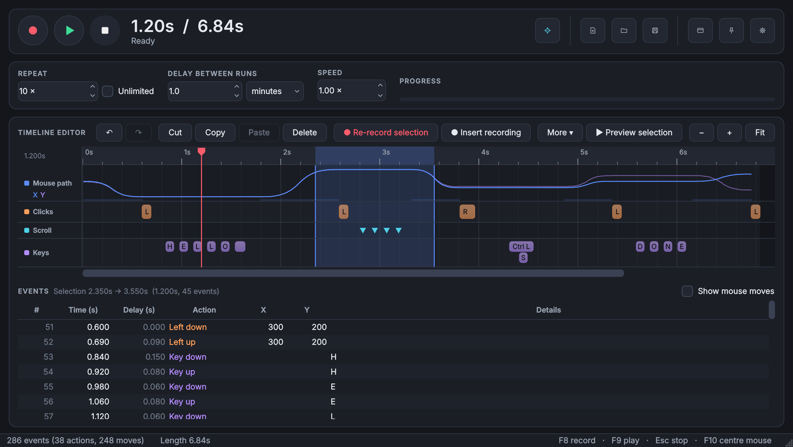

<div align="center">

# More Than Tiny Task

**Record your mouse & keyboard. Edit it like a video. Replay it as many times as you want.**

A free Windows macro recorder inspired by TinyTask, with a timeline editor, partial re-recording,
delays between runs and a one-key "centre the mouse".

[](https://github.com/BarBaroNN/more-than-tiny-task/releases/latest/download/MoreThanTinyTask.exe)
&nbsp;
[](https://github.com/BarBaroNN/more-than-tiny-task/releases/latest)


</div>

## Why not just TinyTask?

TinyTask is great until you mess up one click in a 2-minute recording and have to redo the whole thing.
More Than Tiny Task keeps the same **record → play** simplicity and adds:

| | TinyTask | More Than Tiny Task |
|---|:---:|:---:|
| Record & replay mouse / keyboard | ✅ | ✅ |
| Repeat N times or forever | ✅ | ✅ |
| **Wait between runs** (e.g. 10 runs, 1 min apart) | — | ✅ |
| **Timeline editor** (cut, copy, paste, move, delete) | — | ✅ |
| **Re-record just one part** of a macro | — | ✅ |
| **Glide the mouse to the screen centre** with a hotkey | — | ✅ |
| Custom hotkeys, stay on top, compact mode, tray | — | ✅ |
| Undo / redo | — | ✅ |

## Download & run

1. Download **[MoreThanTinyTask.exe](https://github.com/BarBaroNN/more-than-tiny-task/releases/latest/download/MoreThanTinyTask.exe)** (Windows 10 / 11).
2. Double-click it. No installation needed.

> **"Windows protected your PC"?** The app isn't code-signed (certificates are expensive), so SmartScreen warns about it. Click **More info → Run anyway**. Some antivirus tools also flag macro recorders because they read keyboard input. The exe is built automatically from this source code by GitHub Actions, and every release lists its SHA-256 checksum.

## How to use it

| Key | What it does |
|-----|--------------|
| **F8**  | Start / stop recording |
| **F9**  | Start / stop playback |
| **Esc** | Emergency stop |
| **F10** | Glide the mouse to the centre of the screen |

All hotkeys work while other windows are focused and can be changed in **Settings → Hotkeys**. They are never recorded into your macro.

1. Press **F8**, do your thing, press **F8** again.
2. Set **Repeat** (or tick *Unlimited*), an optional **Delay between runs**, and the **Speed**.
3. Press **F9**. Press **Esc** at any time to stop.
4. **Ctrl+S** saves the macro as a `.mttk` file. Drag a file onto the window to open it.

### Fix one part without redoing everything



- **Drag** across the timeline to select the part you want to change. Drag the blue edges to fine-tune it.
- Press **● Re-record selection** (Ctrl+R) and do that part again. Only the selection is replaced and everything after it shifts to fit. The cursor is first moved to where it was at that moment, so the new take joins up with the rest.
- **● Insert recording** (Ctrl+I) adds a new take at the red playhead.
- **Cut / Copy / Paste / Delete** work on the selection. **More ▾** has *insert pause*, *change speed of a section*, *trim* and *remove / simplify mouse moves*.
- **Click** a key or click block to select it and **drag** it to move it in time. Double-click to edit exact times, delays and coordinates in the event table.
- **▶ Preview selection** plays only the selected part. **Ctrl+Z / Ctrl+Y** undo and redo everything.
- **Ctrl + mouse wheel** zooms, the mouse wheel scrolls, **Fit** shows the whole macro.


### Small and always on top

The **pin** button keeps the window above your game or app, and **compact mode** hides the editor:


Under **Settings** you'll also find window opacity, minimize to tray, auto-hide while recording or playing, a small click-through **REC / PLAY** indicator, a countdown before recording, mouse-move sampling and the centre-mouse options (which monitor, animation speed and style).


## Tips

- **Admin apps / some games:** Windows blocks input from normal programs into apps running as Administrator. Right-click the exe → **Run as administrator** if playback doesn't reach them.
- **Display scaling:** record and play on the same monitor setup and scaling, because mouse positions are absolute.
- **Huge recordings:** *More ▾ → Simplify mouse moves* thins out mouse movement without touching clicks or keys.

## Run from source

Requires Python 3.10+.

```bat
git clone https://github.com/BarBaroNN/more-than-tiny-task.git
cd more-than-tiny-task
run.bat
```

`build.bat` builds `dist\MoreThanTinyTask.exe` locally. To publish a new version, see [RELEASING.md](RELEASING.md).

<details>
<summary>Development</summary>

```bash
pip install -r requirements-dev.txt
python -m pytest -q tests
```

- `mttk/model.py`: event model and pure editing operations (unit tested)
- `mttk/backend.py`: recorder, player, global hotkeys, mouse centring (pynput)
- `mttk/ui/`: PySide6 interface (timeline, event table, settings, theme)

</details>
