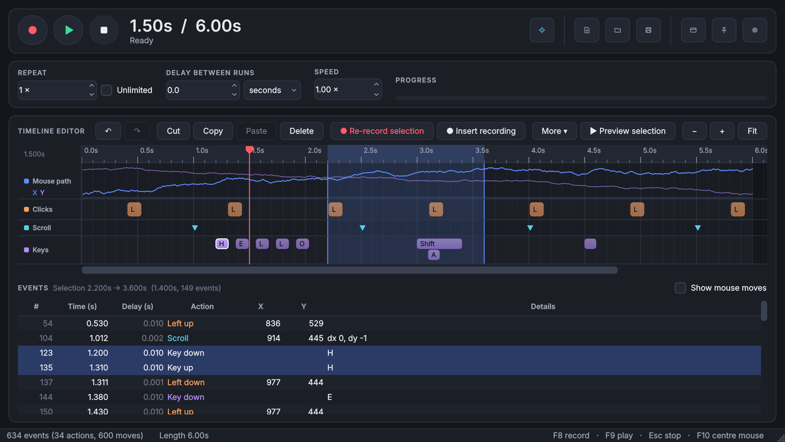

# More Than Tiny Task

A macro recorder for Windows in the spirit of TinyTask: record your mouse & keyboard, play it back as many times as you want. Plus the things TinyTask is missing: a **timeline editor**, **re-recording just one part**, **delays between runs**, and a **centre-the-mouse key**.



## Features

**Record & play**
- Records mouse moves, clicks, scrolling and keyboard with precise timing.
- Repeat **N times** or **unlimited**, with a **delay between runs** (seconds / minutes / hours) and a live countdown.
- Playback **speed** control (0.1× – 20×).
- Held keys / mouse buttons are released automatically when playback stops.

**Timeline editor** (like a video editor)
- Tracks for mouse path (X/Y graph), clicks, scroll and keys. Zoom with **Ctrl + mouse wheel**, scroll with the wheel.
- Drag on the timeline to **select a range**; drag the blue edges to adjust it. Click the ruler to move the playhead.
- **Re-record selection** (Ctrl+R): record a new take that replaces only the selected part — everything after it shifts automatically. The cursor is first moved to where it was at that point so the take connects seamlessly.
- **Insert recording** (Ctrl+I) at the playhead.
- Cut / Copy / Paste / Delete (ripple editing), insert pause, change speed of a section, trim, remove or simplify mouse moves.
- Click an event to select it, **drag it to move it in time**, or edit exact time / delay / X / Y in the event table.
- **Preview selection** plays only the selected part. Full **undo / redo**.

**Mouse centring** — a hotkey smoothly glides the cursor to the centre of the screen (current or primary monitor; duration & easing configurable). Works while recording too — the glide is recorded.

**Window options** — stay on top, compact mode, opacity, tray icon / minimize to tray, auto-hide while recording or playing, small click-through on-screen REC/PLAY indicator, countdown before recording.

## Default hotkeys (global, changeable in Settings → Hotkeys)

| Key | Action |
|-----|--------|
| F8  | Start / stop recording |
| F9  | Start / stop playback |
| Esc | Emergency stop |
| F10 | Glide mouse to screen centre |

Hotkey keys are never recorded into the macro.

## Running

**Ready-made exe:** every push builds `MoreThanTinyTask.exe` in GitHub Actions — open the repo's **Actions** tab → latest run → *Artifacts*.

**From source** (Python 3.10+): double-click `run.bat`, or

```bat
pip install -r requirements.txt
python -m mttk
```

**Build the exe yourself:** double-click `build.bat` → `dist\MoreThanTinyTask.exe`.

Macros are saved as `.mttk` files (JSON). You can drag a file onto the window, or pass it on the command line.

> Tip: to automate apps running as Administrator, run More Than Tiny Task as Administrator too (Windows blocks input from normal apps into elevated ones).

## Development

```bash
pip install -r requirements-dev.txt
python -m pytest -q tests
```

- `mttk/model.py` – event model and pure editing operations (unit tested)
- `mttk/backend.py` – recorder, player, global hotkeys, mouse centring (pynput)
- `mttk/ui/` – PySide6 interface (timeline, event table, settings, theme)
